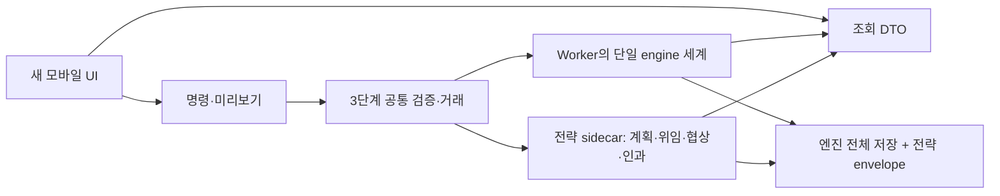

# 2단계 — 구조·데이터 기준 확정

현재 생활 기능·지역 경제·저장 v3와 검증 범위는 [5단계 기록](LIVING.md)을 따른다. 아래 내용과 관측값은 해당 단계 당시의 기록이다.

이 문서는 2단계 시점의 확정안과 검사 기록이다. 이후 구현한 공통 명령 실행기·계약 등록·저장 v2와 현재 연결 범위는 [3단계 기록](COMMANDS.md)을 따른다.

판정: **설계 확정과 독립 경계 검증 완료**. 공통 행동 실행기·새 UI·새 경제·자율 계획자의 구현 완료를 뜻하지 않는다. 실행 중인 주소와 저장 파일은 아직 바꾸지 않았다.

## 확정 결정

1. 최종 게임의 기준 세계는 `engine.js:createWorld()`의 `S`다. 5,000명 주민, g/q, 기존 공간·생산·소유·채무·정치·가족을 유지한다. 기존 클로저는 단계적으로 분리하며, UI까지 기존 구조를 유지한다는 뜻은 아니다.
2. 한 Worker에 한 세계, 한 시간 루프, 한 회계 상태만 둔다. 새 전략 기능은 같은 주민·회사·정부를 참조한다. `rebuild/game.js`의 60명 세계 및 `systems.js`의 경제 계산을 기준 엔진과 병행 실행하지 않는다.
3. UI를 새로 만든다. 브라우저는 조회 DTO와 명령만 사용한다. `server-presenter.js`의 VM/HTML 조각은 기존 UI 호환 경로에만 남긴다. 새 UI가 엔진의 전역 `S`를 흉내 내거나 직접 수정하지 않는다.
4. 기존 금액·날짜·주민 ID는 변환하지 않는다. `YEAR=60`, 나이는 일수, 성년 판정은 엔진의 `isAdult`를 사용한다. `S.currency.unit`은 표시 배율이며 회계 금액의 배율이 아니다.
5. 새로운 계획·협상·위임·인과 기록은 전략 sidecar에 둔다. 기존 자산·직위·잔액·가족·g/q의 사본을 별도 정답으로 두지 않는다. 아직 없는 기능은 후속 단계가 소유자를 추가하고 버전을 올린 뒤 구현한다.

이 그림은 목표 구조다. 현재 서버는 1단계에서 조사한 두 게임 경로를 계속 사용한다. 이번에 추가한 `rebuild/core/session.js`는 목표 경계의 보존 가능성을 검사하는 독립 모듈이며 서버가 import하지 않는다.

## 상태 소유권과 신원

| 상태 | 유일한 기준 / 식별 | 수정 주체와 계약 |
| --- | --- | --- |
| 주민·학습·기술·직업·건강·보유품 | `S.agents`, `S.byId`, 주민 `id`, `g`, `q`, `inv`, `gear`, `know` 등 | 엔진의 출생·죽음·학습·행동. 전략 목표를 g/q 대신 넣지 않음 |
| 제어하는 인물 | sidecar `playerId` → 같은 주민 ID | 새 인물·지갑을 만들지 않음. 사망하면 사망 신원을 유지하고 12단계 계승 거래로만 변경 |
| 배우자·혈연·세대·가문 | 주민 `partner/parents/kids/family/gen`, `S.dyn`의 가문 운영 정보 | 혈연은 주민 참조가 기준. 별도 `family.members` 배열은 최종 모델에 사용하지 않음 |
| 개인 돈·예금 준비금·재고 | 주민 `cash/dres/inv/gear` 등 | 기존 거래가 현재 작성자. 3단계 계정 어댑터로 접근을 통합. 자산 평가액 `w/peak`는 잔액이 아님 |
| 회사·지분·임원·고용 | `S.firms`의 `id`, `cash/sh/ceo/bld`, 주민 `firm/emp` | 회사 계정과 개인 계정을 분리. 지분 키의 개인·기관·자사주 구분은 기존 holder 해석을 따름 |
| 주택·임대·전세·점유 | `S.houses`의 `id`, `owner/occ/rent/jeon/deposit` 등 | 소유·거주·임대권을 별도 권리로 취급. 정부 수반·기업 대표라는 이유로 개인 소유로 바꾸지 않음 |
| 건물·점포·설비·공사 | `S.bldgs/S.shops/S.sites` | 건물·점포는 각 `id` 영역. 공사는 안정 ID 등록 전 조회만 제공. owner/firm/builder 역할을 구별 |
| 필지·집터·지형·도로·지도 | `S.plots`, `S.geo`, `S.lotOwn/lotUsed/lotSale`, `S.terr` 등 | 필지/집터는 저장된 배열 인덱스가 신원. 재정렬·삭제로 인덱스를 당기지 않고 폐기 표식 사용. 편집실도 동일 |
| 정부·정책·공공 계정·관직 | `S.gov`, `S.gov.policy`, 중앙·부처·지역 계정 및 `S.dist/S.gu` | 직위는 공금 지출 자격이며 소유권이 아님. 자격·관할·예산을 3단계 실행 직전에 재검사 |
| 정당·집단·종교·조직 | `S.groups/S.faiths`의 `id`, 주민 소속 참조 | 기존 실제 주민·조직을 사용. 고정 상대 점수·가상의 의석을 기준으로 사용하지 않음 |
| 은행 | `S.banks[].id`, 운영자 `own` | 은행 조직 ID와 운영 주민 ID는 다름. 예금 `bank`는 현재 **운영 주민 ID**여서 은행 조직 ID로 재해석 금지 |
| 개인 대출·기업 대출 | `S.loans/S.corpLoans`의 `id`, `S.nextLoan` | 채권자·채무자·기한·원리금·담보·연체·상속을 유지. 같은 숫자여도 참조 kind로 목록 구별 |
| 예금·고용·임대 등 내장 계약 | `S.deps`, 주민·주택·회사에 내장된 현재 계약 필드 | 별도 ID가 없는 계약을 배열 순서나 `(예금주,은행)`만으로 유일하다고 간주하지 않음. 아래 등록 계약 적용 |
| 기존 사건·기억·정치 결정 | `S.events/miles/rumors`, `S.dyn.pending/chron` 등 | 기존 콘텐츠는 재사용. 완료·실패·대기 구분을 유지. 새 인과 기록과 연결할 때 원본 사건 ID 및 주체 참조 명시 |
| 목표·계획·위임·협상·새 결정·인과 | 향후 sidecar의 버전 있는 엔터티 | 주민·조직·자산 참조와 조건만 소유. 금액·가족·직위의 중복 잔액표 금지. 7·8·11단계 구현 |
| 편집실·실험 분기 | 별도 worldId/저장 공간의 동일 엔진+sidecar | 플레이 세계와 섞지 않음. 수정은 별도 편집 명령·검증·복구 체크포인트를 거침. 13단계 구현 |
| 난수·시간·ID 카운터 | 엔진 `rng/S.day/nextId/nextFirm/nextLoan…` | 엔진만 갱신. 새 전략 난수는 별도 직렬화 스트림으로 추가해 기존 난수열을 소비하지 않음 |
| 기타 현재/미래 엔진 필드 | 모든 나머지 `S` 필드는 기본적으로 엔진 소유 | 알 수 없는 필드도 엔진 저장 그대로 보존. 스키마를 아는 일부만 골라 재생성하지 않음 |
| 좌표 보간·선택·팝업·캐시 | UI 또는 Worker 조회 캐시 | 권리·잔액·학습의 기준으로 사용하지 않음. 엔진의 기존 export가 제외하는 렌더 캐시와 일시 데이터를 영속 상태로 간주하지 않음 |

참조 계약은 `{kind,id}`다. person/firm/house/building/shop/bank/group/faith/district/borough/loan/corporateLoan/design은 해당 목록의 ID, plot/lot은 0부터 시작하는 보존된 인덱스다. 다른 세계의 같은 숫자와 혼동하지 않도록 HTTP 요청에는 worldId도 넣는다. 조회는 복사본을 돌려주고 없는 참조는 null, 모호한 중복 ID는 오류다. 이름을 키로 찾거나 죽은 주민의 ID를 새 주민에게 재사용하지 않는다.

**ID 없는 계약 등록 결정:** 3단계에서 기존 계약 객체에 영속 `contractId`를 한 번 부여하고 `nextContractId`와 함께 저장한다. 고용처럼 여러 필드에 걸친 계약은 당사자·유형·시작 revision과 원본 필드 위치를 가진 등록부를 만들고 기존 엔진의 갱신/종료와 함께 갱신한다. 동일 예금주·은행의 복수 예금은 서로 다른 ID다. 등록 전에는 개별 계약 수정 명령을 허용하지 않는다. 불명확한 계약을 합치거나 새 조건으로 묵시 재작성하지 않는다. 현재 독립 모듈은 ID 없는 계약 참조를 명시적으로 거부하며 등록 자체는 아직 구현하지 않았다.

## 명령·조회·시간 호출 계약

실사용 프로토콜은 3단계에서 구현한다. 다음 형식과 실패 기준을 고정한다.

- 명령: `{worldId, commandId, expectedRevision, actor:{kind:'person',id}, action, target, args, previewToken?}`. actor의 실재·생존·제어권·역할·관할을 Worker가 확인한다. 클라이언트가 준 비용·잔액·확률은 신뢰하지 않는다.
- 미리보기: 동일 action 평가기로 `{allowed,reasons,accounts,costs,duration,requirements,effects,uncertainty,revision}`를 만든다. 미리보기 자체는 난수·돈·시간을 소비하지 않는다. 예상 효과와 확정 효과를 구별한다.
- 실행: revision 및 미리보기 조건을 재검사하고 원자적으로 반영한다. 실패하면 경제·학습·난수·전략 상태 모두 그대로다. 성공하면 revision을 한 번 올리고 인과/회계 기록과 변경 참조를 반환한다. 같은 commandId 재전송은 중복 집행하지 않는다. 거절도 구조화된 이유를 준다.
- 시간: Worker 큐에서 명령·시간 전진·저장·가져오기를 직렬화한다. **`world.step()` 한 번만 하루**다. 엔진의 몸 상태→구인/행동/학습→부양→정치→시장→주택/가족→출생/사망→모방/이주→기록 순서를 이번 단계에서 바꾸지 않는다. 현재 코드의 세부 호출 순서는 `engine.js:step`이 기준이다.
- 앞으로 새 계획자는 직전 확정 상태에서 의도를 만들고 공통 명령 실행기로 실행한다. 별도의 수입·임금·생산 tick을 추가하지 않는다. 기존 계산을 교체할 때 먼저 기존 작성자를 끄고 같은 영역에 작성자를 하나만 둔다. classic 세계에는 새 전략 동작을 켜지 않는다.
- 결정 대기 중에는 시간 전진을 중지한다. 재검사 실패는 대기 사유와 갱신된 선택지를 반환한다. 벽시계의 대기 시간은 게임 날짜·계약 기간으로 환산하지 않는다.
- 조회: summary, 지도 viewport, 대상 상세, 작업 미리보기, 결과/활동, 비교, 탭별 집계로 분리한다. 응답에 worldId/revision/day를 넣고 다른 revision 조각을 합치지 않는다. 전체 g/q는 선택한 주민 상세와 전체 저장에만 포함한다. 전체 상태를 주기 전송하지 않는다.
- 저장: 큐의 확정 경계에서 엔진과 sidecar를 같은 revision으로 캡처한다. 기존 gzip→임시 파일→fsync→rename 기반을 재사용한다. 실패한 쓰기는 기존 저장을 보존한다. 가져오기는 별도 Worker에서 검증 후 교체하고 실패 시 현 세계를 유지한다.

새 UI의 조회 소유자는 Worker의 DTO 계층이다. 브라우저 선택·지도 이동·비교함은 로컬 상태, 계산 결과·명령 자격·소유권은 Worker 상태다. 기존 HTML VM을 새 UI API로 노출하는 방식은 채택하지 않는다. 구체 필드와 페이지 전환은 4단계에서 플레이 흐름과 함께 구현한다.

## 저장 포맷·호환성

새 envelope v1은 `{format:'free-village.canonical',version:1,engine:<기존 exportState 전체>,strategy:{revision,playerId}}`다. 현재 코드에는 아직 목표/계약/난수 스트림을 만들지 않는다. 이를 추가할 때 마이그레이터·버전 검사·실행 검증을 같이 추가한다.

| 입력 | 처리 결정 | 이번 단계 구현 |
| --- | --- | --- |
| 현재 엔진 v1 저장 / 기존 브라우저·서버의 해제된 JSON | 원본을 clone한 뒤 기존 importState 적용. g/q·나이·현금·채무·기간·난수 유지. 기존 import가 하는 정규화는 그대로 적용 | 독립 `createSession({legacy,playerId})` 검증 |
| canonical envelope v1 | format/version·신원 검증 후 engine+sidecar를 함께 복원 | 독립 `createSession({checkpoint})` 검증 |
| 과거의 여러 엔진 버전 | 버전별 정규화 차이·계약 연속성을 fixture로 검증해야 함 | 13단계 미완료. 모든 과거 저장 호환이라고 주장하지 않음 |
| 60명 시제품 v2 저장 | 격리된 시제품으로만 계속 열기. g/q·과거 소유권을 원본 archive 없이 복원할 수 없음 | 자동 승격 거부. 원본 archive가 있으면 원본을 기준으로 재시작하고 시제품 진척은 차이 보고 후 명시적 변환 |
| 손상/미래 envelope 버전/알 수 없는 포맷 | 현 세계·원본 파일을 보존하고 거부 | 독립 포맷/신원 검증만 구현. HTTP 업로드 제한·복구 UI는 13단계 |

엔진 export는 원래 렌더 캐시·offers/fx를 제외하고 사건 최근 150개 및 참조된 사망자의 최소 기록을 저장한다. 이번 기준은 **기존 저장 계약 보존**이며 모든 런타임 객체를 무손실 영구 보관한다는 뜻이 아니다. 새 제어 인물의 사망 참조는 envelope에 보존한다. 앞으로 계약·인과가 가리키는 사망자 전체의 참조 보존 정책은 3·11·12단계에서 등록부와 함께 확장한다.

## 파일별 재사용·교체 경계와 실행 전환

| 대상 | 확정 처리 | 연결 단계 |
| --- | --- | --- |
| `engine.js` 주민·g/q·가족·소유·생산·시장·정치·난수·저장 | 기준 상태와 계산 재사용. 클로저에서 필요한 조회/거래 인터페이스를 점진 추출. 기존 행동이 최종 요구를 충족한다는 의미는 아님 | 3, 5~12 |
| `dynActions/dynAct/dynChoose`, 공개 계정/자격 검사, 거래 복구 | 현재 구현을 출발점으로 공통 평가/실행 계약에 통합. 문자열 분기·사건별 별도 비용 산식은 통합 대상 | 3 |
| `SE/FOLLOW`, 기존 사건 콘텐츠·가족/상속 규칙 | 콘텐츠·규칙 재사용. 사건 생성·협상·기억·계승 범용화는 후속 구현 | 8, 11, 12 |
| `sim-worker.js`, `server.js` | 한 활성 Worker·직렬화·경량 전송 기반 유지. canonical 명령/DTO 경로를 추가하고 저장 이름을 분리 | 3, 4, 13 |
| `server-storage.js`, lifecycle, start-gate | 저장·수명 운영 기반 유지. envelope와 장애 검사 추가. 이번 작업에서 AWS 호출 없음 | 13, 14 |
| `server-presenter.js`, `ui2.html`, remote/god-client | classic/god 및 기존 단독 실행 호환. 새 UI는 별도 DTO/컴포넌트로 교체. 기존 지도 정보 재사용 | 4 이후 |
| `rebuild/game/schema/systems/economy/society/politics/family` | 현 시제품 격리. 명령·UI 실험은 참고하되 축약 상태/하루 계산/고정 후보/별도 가족은 최종 경로에서 교체 | 3~12 |
| `rebuild/story/editor/migration` | 예제 콘텐츠·격리 아이디어 참고. 원본 archive 보관을 전체 이전으로 세지 않음. 새 계약에 재작성 | 8, 11, 13 |
| `rebuild/client.js/index.html`, 장면 자산 | CSS·입력·모달의 쓸 부분만 이전. 도식 지도를 실제 공간으로, 카드 메뉴를 작업/비교/결과 흐름으로 교체 | 4~13 |
| `scripts/build.js`, 생성 `index.html` | 기존 단독 실행의 생성 경로 유지. 이번 단계 생성물 변경 없음 | 기존 호환 |

전환 순서: (1) 이번 독립 경계 → (2) 3단계 평가·거래·계약 ID를 격리 검증 → (3) 4단계 새 UI/전용 Worker를 기능 플래그로 연결 → (4) 5~12단계 작성자를 영역별 교체 → (5) 13단계 실제 저장별 이전·성능·복구 검증 후 기본 주소 전환. 그전에는 `/play`를 최종 canonical 게임이라고 표시하지 않는다. classic/god 저장을 덮어쓰거나 모든 주소를 한 세계에 합치지 않는다.

## 검증 결과와 한계

명령: `node scripts/check-canonical-session.js` (Node 24).

- 시드 7·19, 100명 각각 60일: 기존 엔진 직접 실행과 경계 실행의 **전체 export 및 난수 동일**.
- 시드 42, **5,000명** 2일: 전체 주민 g/q를 포함한 시작·종료 export 및 난수 동일. 인구/학습 축약 없음.
- 현재 엔진 저장 가져오기: 입력 객체 불변, 기존 import 정규화와 동일, 메모리 checkpoint 및 실제 JSON 직렬화/복원 뒤 다음 하루도 동일.
- 선택 상세 복사본의 변경이 기준 주민에 반영되지 않음. 중복 세계·잘못된 플레이어·누락 q·중복 주민 ID·미지원 참조/버전 거부. 사망한 제어 인물도 같은 ID로 복원.
- 기존 행동으로 실제 체결한 기업 대출과 회사 지분·은행·가문을 저장/복원하고 다음 하루가 원본과 같음. 결정 큐가 차면 전진을 거부하고, 빈 큐는 진행 가능함을 확인.
- 추가 권리·의무 fixture와 알 수 없는 저장 확장 필드를 보존. 이것은 해당 계약의 경제 집행·상속·원자성을 검증한 것이 아니며 3·12·13단계에서 별도로 검증한다.

실행 모듈은 조회·하루 전진·체크포인트의 보존 경계만 구현했다. 새 명령 프로토콜, 계약 ID 등록, 일반 계획/협상, UI, 장기간 전체 기능 성능, 모든 이전 저장, HTTP/디스크 장애, AWS·실기기 플레이는 이번 검사 범위 밖이다. 전체 리빌드 완료로 해석하지 않는다.

3단계의 입력은 이 소유권 표·명령 계약이다. 다음 결과물은 공통 자격 평가기·계정 참조·원자적 실행/복구·중복 명령 처리·ID 없는 계약 등록과 표시/실행 일치 검사다. 그 단계가 끝나기 전 실제 서버에 이 독립 모듈의 `advance()`를 연결하지 않는다.
