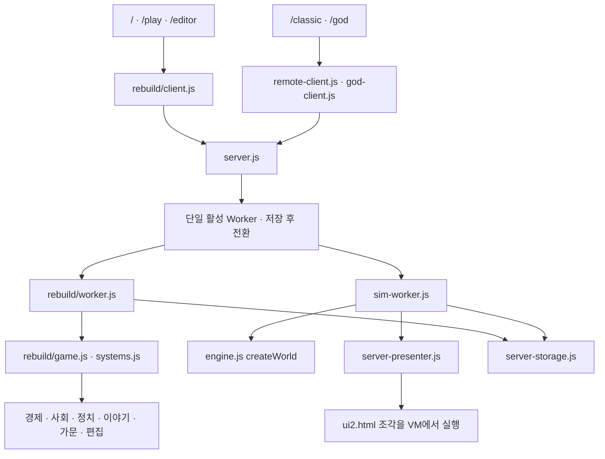

# 실행·상태·재사용 조사

기준: `c48651f`. 함수명과 전체 파일 해시는 [기계 목록](source-inventory.json)에 있다. 여기서 **연결 확인**은 현재 호출 경로를 찾았다는 뜻이며 그 기능의 모든 조건이 옳다는 뜻은 아니다.

## 실행 계통

## 파일별 실제 사용과 처리 범위

| 파일·진입점 | 현재 연결·의존 | 1단계 처리 판정 | 후속 작업 |
| --- | --- | --- | --- |
| `server.js`: makePage, spawnWorld, handleWorld, use | 주소별 HTML·API, 동적 스크립트 삽입, Worker 1개 | 전송·전환 기반 유지, 주소·모델 선택 수정 | 2단계에서 기준 모델을 정하고 경량 API 계약 통일 |
| `server-storage.js`: writeSnapshot | 두 Worker의 gzip·fsync·원자 교체 | 저장 기반 유지 | 스키마·마이그레이션·장애 조건은 13단계 확장 |
| `server-lifecycle.js`, `infra/start-gate.js` | 접속 수명·저장 후 EC2 중지·시작 진입점 | 운영 기반 유지 | 14단계에 배포 환경·접속 종료 검증. 이번 조사에서 AWS 호출 안 함 |
| `engine.js`: createWorld, step | classic/god 주민 g/q, 생활·거래·정치·가족의 공통 세계 | 주민·학습·권리·경제 재사용 후보, 대규모 클로저의 결합 수정 | 새 계산과 중복하지 않는 재사용 경계를 2단계에 확정 |
| `engine.js`: dynActions, dynAct0/dynAct, dynChoose0/dynChoose | 목록·문자열 접두어 정규화·핸들러·거래 복구 | 규칙·권한·거래를 추출/수정할 대상 | 3단계 공통 규칙; 기존 행동을 무조건 삭제하거나 전체 재구현하지 않음 |
| `engine.js`: SE, DYN_H, FOLLOW, dynStoryEligible/Recheck | 고정 사건·조건·후속 분기·재검사 | 콘텐츠·기억 연결 재사용 후보, 사건 생성·자격 수정 | 3·11단계에 규칙과 콘텐츠를 분리 |
| `sim-worker.js`: newWorld, advance, makeView, handleMessage | 엔진 실행·고정 시간 루프·뷰 캐시·전체 저장 | Worker 운영 기반 유지·뷰 어댑터 수정 | 새 UI의 데이터 요구와 기존 주민 상세를 연결 |
| `server-presenter.js`: fragments, bind, panel/card | ui2.html 함수 조각과 DOM 모형·VM에 결합 | 호환 경로 유지, 새 UI 의존에서는 교체 | 기존 카드·탭 제거 시 VM 의존이 깨지는 점을 관리 |
| `ui2.html`, `remote-client.js` | 기존 캔버스 지도·탭·주민 카드, 서버 뷰를 전역 S에 대입 | 지형·상태·정보 재사용 후보, 사용자 조작 구조 교체 | 4단계의 새 대상·비교·작업 UI에 데이터 어댑터 작성 |
| `god-client.js` | 기존 화면 위에 가문 탭·행동 목록·팝업 추가 | 사건·인물 표현 재사용 후보, 메뉴·알림 중심 구조 교체 | 4·9·11·12단계의 역할별 화면에 연결 |
| `scripts/build.js`, `index.html` | engine.js+ui2.html+remote-client.js를 합침 | 생성 경로 유지·용도 명확화 | index.html은 기존 단독 실행물. 직접 편집하지 않음 |
| `rebuild/game.js` | 별도 60명 생성, 명령/계획/일별 처리, systems 선처리 | 원자적 명령·계획은 후보, 축약 세계를 최종 모델로 채택 보류 | 2단계 상태·시간·회계 기준 결정 후 분리/수정 |
| `rebuild/schema.js` | 별도 v2 상태·기본 가족/정당/지역·검증 | 임시 스키마·보완 규칙 수정 | 기존 신원·학습·권리와 합칠 데이터 계약 필요 |
| `rebuild/economy.js` | 세 상품·공통 raw·소매·운송·경쟁자 조건문 | 개념 실험으로 유지, 생산·계약·경쟁 모델 수정 | 5~8단계 실제 경제와 일반 협상 |
| `rebuild/society.js` | 3경로, 지역 주거 수용량, 고정 집단 평가 산식 | 축약 계산 수정 | 실제 공간·주택·생활·집단 형성과 연결 |
| `rebuild/politics.js` | 고정 상대 점수·9석·3정당·3제도·임계값 개편 | 정책·권한 진입점 후보, 후보·의회·세력 모델 교체 | 7·9·10단계 실제 주체와 제도 |
| `rebuild/story.js` | 일부 날짜·상태 조건과 사건별 선택 처리 | 예시 콘텐츠 후보, 범용 협상/인과 체계 교체 | 8·11단계 정보·조건·계약·기억 통합 |
| `rebuild/family.js` | 별도 가족 배열, 교육·혼인·유언·계승 | 가문 조작 예시 유지, 주민 신원·권리 모델과 통합 | 2·12단계 가족·주민·자산·상속 일치 |
| `rebuild/editor.js` | 지역·인물·정부 일부 수치 편집 | 별도 권한·저장 분리 유지, 편집 범위 확장 | 13단계 세계 편집·실험·되돌리기 |
| `rebuild/migration.js` | createGame 기본값에 주민·현금·국고 일부 복사 | 전체 이전으로 부르면 안 됨. 변환 방식 수정 대상 | 기존 권리/의무별 보존·변환 계약을 2·13단계에 설계 |
| `rebuild/worker.js` | 새 게임 저장·가져오기·원본 보관·조회 | 전송·저장 기반 재사용, 변환 어댑터 수정 | 원본 보관과 플레이 상태 이전을 분리 검증 |
| `rebuild/systems.js` | 모듈 순서·명령 선처리·성취·뷰 필터 | 조합 기반 후보, 역할·목표·뷰 계약 수정 | 계산 소유권·서브시스템 경계를 확정 |
| `rebuild/client.js`, `rebuild/index.html` | 도식 지도·점포 패널·카드·공용 대화창 | 모바일 뼈대 재사용 후보, 정보/작업 구조 수정 | 별도 원본 HTML은 서버가 클라이언트를 삽입해야 작동함 |
| `scene-art/*.webp` | god-client의 SVG 내부 image, 서버 허용 목록 | 자산 유지 후보 | 13단계 장면 적합성·해상도·지연·실기기 검증 |
| `scripts/check-*.js` | 함수·상태·일부 HTTP/브라우저 검사 | 유효한 좁은 검사 유지 | [검사 범위](TEST_SCOPE.md) 밖의 인과·장기 경로·실기기 기준 추가 |

‘유지 후보’는 재사용 결정이 최종 확정됐다는 뜻이 아니다. 기능별 데이터·권한·성능 비교 후 2단계에서 확정한다. 기존 원본 세계를 유실시키면서 축약 모델로 갈아끼우는 것을 기본 전제로 삼지 않는다.

## 상태·시간·권한·UI 연결

| 영역 | 기존 계통 | 새 계통 | 연결/이전에서 해결할 차이 |
| --- | --- | --- | --- |
| 주민 신원 | S.agents, S.byId, 부모·자녀·가족·직업·g/q | S.people와 별도 S.player·S.family.members | 같은 사람/친족/권리의 식별 체계가 다름 |
| 결정·학습 | engine.step의 q 기반 직업 결정·학습·모방, births의 유전/학습 | 무직 지급·조건부 이직·고정 소비/생산 | 새 게임은 유전자·학습 기반 주민 시뮬레이션을 이어가지 않음 |
| 시간 | YEAR=60 기준 step, Worker 재생·속도·대기 | 명령으로 1~30일, 30일마다 나이·선거 | 나이·세대·계약·임기·사건 기한의 의미가 달라짐 |
| 공간 | 지형·부지·주택·건물·구역·주민 좌표 | 3지역·9점포·3경로, 별도 렌더 좌표 | 원본 공간의 권리·거리·시설을 잃지 않을 변환 필요 |
| 경제 | 재고·생산·회사·지분·금융·부동산·정부 회계 | raw·3상품·사업 cash·시장/국고·예약액 | 일부 금액 보관만으로 기존 경제 연속성을 보장할 수 없음 |
| 정치 | 여러 체제·공직·의회·조직·지역·외교 | P.office·고정 정당·9석·3제도 | 새 정치가 기존 권리·조직·주민 기반을 재사용하지 않음 |
| 사건 | SE/DYN_H/FOLLOW, S.dyn.pending/storyHist/chron | events/promises/notes, 사건별 분기 | 기존 사건과 새 협상의 문맥·자격·시간을 통합해야 함 |
| 권한 | dynActions.ok와 실행 정규화·dynTransaction·공공 계정 | 모듈 command + game.command 스냅샷 복구 | 화면/미리보기/실행 규칙의 단일 기준 없음 |
| UI | 전역 S + 서버 패널 HTML + 가문 탭/팝업 | JSON 뷰 + HTML 카드/대화창, 수동 ACTION_TIME | 동일 상태·권리·예측 결과를 설명하는 뷰 계약 필요 |
| 편집 | 기존 god는 가문 게임이지 세계 편집기가 아님 | 별도 editor 세계, 일부 숫자 편집 | 이름·기능·권한·실험 복구 범위를 정리해야 함 |

## 중복·미사용·임시 경로

| 근거 | 현재 사용 판정 | 처리 |
| --- | --- | --- |
| game.command가 `systems.command(c)`를 먼저 호출 | economy.policy, family.educate/succession가 참을 반환하므로 game.js의 같은 case는 현재 정상 디스패치에서 실행되지 않음 | 2단계에서 명령별 단일 소유자 정리. 이번 조사에서는 삭제하지 않음 |
| worker.js 초반 people/resident/export 처리 후 return | 뒤쪽 try의 export 분기는 같은 메시지에 도달할 수 없음 | 이전 잔여 분기, 저장·조회 경계 정리 시 제거 후보 |
| game.js의 POLICIES와 economy.js RULES, client.js ACTION_TIME | 방침·미리보기 정보가 별도 정의됨 | 3단계 공통 명세와 실제 실행값 일치 검증 필요 |
| schema의 f.contractOnly/f.reserve/f.credit, promise.reserved | 런타임 검색에서 초기화 외 실제 처리 소비 경로를 찾지 못함. `reserve` 방침의 지역 변수는 별개 | 미구현용 필드/잔여 필드 후보. 의도 확인 후 구현·제거 결정 |
| schema의 지역 resource와 사이트 x/y | 표시/기본값과 생산/렌더 경로가 분리됨 | 실제 자원 유형·좌표를 사용하도록 설계하거나 오해를 낳는 필드 정리 |
| p.goal | 생성·화면·면담에서 사용, 목표 계획/실행에 사용되지 않음 | ‘인물 목표 시스템 구현’으로 세지 않음 |
| S.goal | 목표 선택을 저장하지만 계획이나 주민 행동을 구성하지 않음 | 목표·다음 단계·평가 체계를 8단계에 연결 |
| government.opposition, crown | 변경·보관되지만 반대 조직 행동/왕실 권리 행사로 소비되지 않음 | 7·10단계의 실제 주체/권리로 연결 |
| index.html와 engine/ui2/remote | build가 만드는 의도된 중복이며 런타임 별도 엔진이 하나 더 있다는 뜻은 아님 | 원본 수정 후 빌드, 생성 파일 직접 수정 금지 |
| 두 Worker의 restore/save/view/command와 두 UI의 지도/카드/사건 | 실제로 다른 세계에 연결되어 모두 사용 중. 단순 미사용 파일이 아님 | 데이터 기준 확정 전 어느 쪽도 통째로 삭제하지 않음 |

이 검색은 전체 JS/HTML과 명시적 require/case를 대상으로 한다. 동적 키·문자열 속성 참조가 생기면 미사용 판정은 다시 확인해야 한다.

## 기존 저장 변환표

| 원본 | 현재 새 실행 상태 | 판정 |
| --- | --- | --- |
| 주민 ID·이름·현금 | 플레이어를 제외한 S.people에 복사, 플레이어는 별도 cash | 제한적 복사 |
| 나이 | `/60` 후 최소 18로 올림, 플레이어 가족 기본 나이 사용 | 나이·세대 연속성 미보장 |
| g/q | 원본 보관, Worker가 새 people에서 제거 | 보관만 됨, 실행 학습 이전 아님 |
| 직업·고용·관계·원래 가족 | job=null, relation=0, 새 기본 가족 | 이전 안 됨 |
| 회사·지분 | S.firms=[] | 이전 안 됨 |
| 주택·토지·건물·매물 | 기존 객체를 옮기지 않고 지역 주거 용량 생성 | 이전 안 됨 |
| 대출·예금·기업 부채·담보 | 새 빈 금융 상태 | 의무·권리 이전 안 됨 |
| 정부 | 국고 일부만 복사, 기본 republic 및 정당·의회 사용 | 직위·법·기관·세력 이전 안 됨 |
| 기존 사건·약속·이야기 분기·일정 | 기본 빈 events/promises/plans | 진행 상태 이전 안 됨 |
| 기존 day·난수 진행 | 새 첫날·시드 초기 상태 | 원래 진행 이어하기 아님 |
| 원본 전체 | 별도 gzip 보관, 내보낼 때 함께 포함 | 원본 보존 경로 존재. 위 항목의 의미상 이전을 대신하지 않음 |

2단계에서는 기존 세계의 신원·자산·권리·의무를 기준 데이터로 정의하고, 13단계에서는 각 항목의 변환·미지원·복원 시나리오를 검증해야 한다.

## 기존 기능의 도메인 목록

기존 기능을 새 시제품의 세 상품·세 제도만으로 대표시키지 않는다. 아래는 실제 엔진 함수와 검사 파일을 찾은 영역이다. 새 게임의 이전·노출·개편 여부를 2단계에서 명시하고, 그 전에는 기존 경로와 데이터를 보존한다. 검사 파일의 존재는 이번 조사에서 그 기능 전체가 검증됐다는 뜻이 아니다.

| 영역 | 기존 코드의 주요 지점 | 관련 검사 예 | 범위 판정 |
| --- | --- | --- | --- |
| 주민 결정·유전·학습·모방 | randGenome, childGenome, initQ, step, q 갱신·blendGenome | check-village-invariance, check-dynasty | 재사용 핵심 후보. 새 엔진에는 이에 대응하는 학습 과정 없음 |
| 출생·죽음·가족·교육 | mate, births, die, schoolTick, familyOf | check-war-family, check-marriage-policy | 주민 신원·가문·재산과 함께 이전해야 함 |
| 생산·상품·기술·직업 | step의 PROD, firmIndTick, labInvent, 도구·제조품 정의 | check-v74-features, check-daily-work | 세 상품으로의 축약을 기존 기능 이전으로 세지 않음 |
| 지형·주택·토지·건물·건설 | createWorld 지형/LOTS, firmProject, building 관련 함수·부지 권리 | check-world-map-seed, check-building-acts | 실제 공간과 자산 권리의 재사용 후보 |
| 회사·경영·경쟁·주식 | firms, coTick/coActions/coAct, stockOwnership, votingShares, tradeCompanyShares | check-company, check-stocks, check-corporate-actions | 소유·지분·노동·경영의 데이터 및 규칙을 함께 평가 |
| 은행·예금·개인/기업 대출 | bankTick, bankLedger, activeLoans, closeLoan, closeCorpLoan, defaultLoan | check-bank-operations, check-corporate-loan | 원본 계약·담보·상환 의무를 보관만 하고 종료한 것으로 취급하면 안 됨 |
| 부처·지역 행정·공공 회계 | minTick, guGovTick, distGovTick, goAct, dynPublicAccount/Spend | check-gov-org, check-dynasty-government, check-dynasty-finance-integrity | 재사용 규칙 후보, 권한·예산·인사를 새 기관 모델에 통합 |
| 정당·선거·의회·법·체제 | councilElection, election, councilVotes, regTick, rcReady/rcAct | check-politics, check-regime-change, check-political-eligibility | 상대 후보 점수만 있는 새 모델로 전체 이전됐다고 할 수 없음 |
| 경찰·검사·재판관·사법부 | duActions/Act/Tick, jrActions/Act/Tick | check-duty, check-judiciary, check-contextual-consistency | 공직·조직·겸직·권한·사건 자격으로 연결할 기존 영역 |
| 범죄·조직·음지 경제 | crTick, crActions, crAct 및 crime 접두어 | check-crime, check-underworld-business, check-heist | 새 세력 모델 설계 때 유지·노출 범위를 명시 |
| 종교·교단·전도·신정 | faithOf, faithHas, dynFaith*, dynPreach*, 교리 사건 | check-faith-found, check-preach, check-heresy | 세력·가치·관계와 이어지는 기존 콘텐츠/규칙 후보 |
| 무역·외교·먼 나라·전쟁 | initTrade/tradeTick, dynDip, farInit/Tick/Act, milTick | check-worlds, check-far-world | 마을 내부 물류와 다른 계통. 새 세계와의 경계 필요 |
| 군 복무·용병·전쟁 후유증·첩보 | wfActions/Act/Tick, mcActions/Act/Tick, dynSpy* | check-mercenary, check-spy-career, check-war-family | 인물·조직·계약·세력의 권리를 보존할 대상 |
| 생활·사회·관계 | ecActions/Act/Tick, scActions/Act/Tick, rrActions/Act/Tick, adActions/Act/Tick | check-social-life, check-relationships, check-economy-expansion | 정해진 새 면담 몇 개가 전체 관계 시스템을 대체하지 않음 |
| 이야기·특별 사건·후속 사건 | SE, SE_TRIG, FOLLOW, sCtx, dynStoryPick/Trig/Tick | check-story-engine, check-story-fuzz, check-event-scenes | 자격·회계·상대 신원과 함께 콘텐츠 재사용 여부 평가 |
